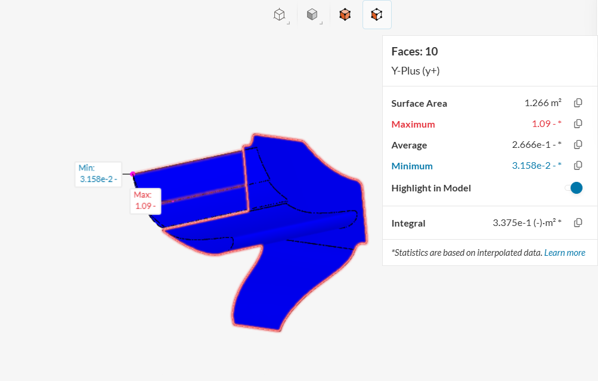

# Portfolio assets

Store images and diagrams that are safe to publish. Use descriptive filenames, explain each figure in
its project page, and include units and simulation conditions where available.

## Structure

```text
assets/
├── css/site.css          # Design system: tokens, components, dark/light themes, print styles
├── js/site.js            # Theme toggle, figure lightbox, TOC scroll-spy, SVG charts
├── formula-student/      # 38 original figures from the Formula Student aerodynamics report
└── rocketry/
    ├── study-1/          # Study 1 only — 3 mm core, 500/500/240 g/m² glass
    └── study-2/          # Study 2 only — 2 mm core, 240 g/m² glass
```

## Figure conventions

- **Rocketry images are separated by source report.** Do not move or mix figures across the two
  project pages — they come from different rocket models with different layups and load cases.
- **Formula Student figures** are extracted from the author's own analyses in the project report:
  XFOIL polars, ANSYS Fluent contours, SimScale meshes and y⁺ maps, CAD, custom airfoil profiles, and
  OptimumLap output. Third-party images used in the report for literature review (other teams' cars,
  rulebook diagrams, published figures from McBeath/Katz) are **deliberately not included**.
- `cad-yellow-cutout.png` and `cad-dark-cutout.png` are the author's supplied SolidWorks car renders
  with the pale screenshot backdrop removed for transparent composition. The CAD pixels/geometry are
  retained; the background matte is only a display treatment. The case-study figures and analysis
  images remain unmodified.
- Name figures for what they show, not for their figure number in the source document — e.g.
  `cfd2d-pressure-c3.png`, `yplus-map.png`, `lap-speed-trace.png`.
- Every figure on a web page needs meaningful `alt` text and a `<figcaption>` stating what it shows
  and under what conditions.

## Using figures on web pages

Wrap images so they pick up the click-to-zoom lightbox automatically:

```html
<figure class="figure">
  <div class="figure-media">
    
  </div>
  <figcaption><span class="fig-num">Fig 19</span>Wall y⁺ map — the near-wall target verified.</figcaption>
</figure>
```

Add `class="figure-media dark-bg"` for figures with dark backgrounds (Cp plots, airfoil profiles) so
letterboxing matches. Use `.fig-pair` or `.fig-trio` to place figures side by side.

## Size guidance

Keep individual figures under roughly 600 KB where possible; the current `formula-student/` set totals
about 4.3 MB. Prefer PNG for plots, contours and screenshots. Do not commit solver meshes, case/data
files or large datasets — `.gitignore` excludes the common solver outputs, and large files belong in
external storage with a link.
