# Formula Student Aerodynamics — ENP Racing Team

**Role:** Head of Aerodynamics
**Institution:** École Nationale Polytechnique (ENP), Algiers · ENP Racing Team, Aerodynamics Department
**Report:** *Formula Student Aerodynamics — Design and CFD evaluation of a downforce-driven aero package for a low-speed race car*, 53 pp., October 2026 (sole author)
**Methods:** Drag-power budgeting · XFOIL screening · 2D/3D CFD · PSO airfoil design · composite structures · lap-time simulation

**[→ Web case study with interactive charts](../formula-student.html)** · **[→ Back to portfolio](../../README.md)**

> **Scope.** This is a **theoretical study of the design process**. Every value below comes from
> simulation. There is **no wind-tunnel or on-track validation**, and the full-car geometry used
> components that were not yet final. Results are meaningful as *relative comparisons between
> configurations run under identical assumptions* — not as predictions of competition performance.

---

## Contents

1. [The argument](#1-the-argument)
2. [Rulebook constraints](#2-rulebook-constraints)
3. [Step 1 — Drag-power budget](#3-step-1--drag-power-budget)
4. [Step 2a — Airfoil screening](#4-step-2a--airfoil-screening)
5. [Step 2b — 2D parametric CFD](#5-step-2b--2d-parametric-cfd)
6. [Step 2c — Custom airfoils](#6-step-2c--custom-airfoils)
7. [Step 3a — 3D wing, endplates, mounts](#7-step-3a--3d-wing-endplates-mounts)
8. [Step 3b — Full-vehicle CFD](#8-step-3b--full-vehicle-cfd)
9. [Step 4 — Underbody devices](#9-step-4--underbody-devices)
10. [Rear-wing structure](#10-rear-wing-structure)
11. [Lap-time simulation](#11-lap-time-simulation)
12. [Limitations and next steps](#12-limitations-and-next-steps)
13. [Tools and references](#13-tools-and-references)

---

## 1. The argument

Formula Student circuits are slow and corner-dominated. Maximum speeds are around 120 km/h, and the
engine is at wide-open throttle only **15–20% of a lap** (Wordley & Saunders). The car is therefore
**traction-limited, not power-limited**: extra grip is worth more than reduced drag.

That single observation sets the design direction — buy tyre normal load with downforce and pay for
it in drag, because drag is cheap at these speeds. The study derives how much drag is affordable,
designs the rear wing first as the stable primary device, then sizes the front wing to place the
centre of pressure where the chassis needs it.

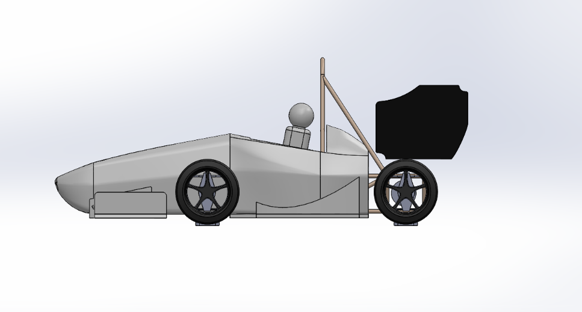

*Figure 1 — The complete package: front wing with footplate, three-element rear wing on swan-neck
mounts, lateral side diffusers and vertical underbody walls.*

### Key results

| Quantity | Value |
|---|---|
| Drag power available for wings | **28.4 kW** of 45.3 kW at the wheels (120 km/h) |
| Allowable rear-wing drag area | **1.25 m²** |
| Airfoils screened / 2D CFD runs | **24** / **27** |
| Downforce with wings | **460 N** against **296 N** drag |
| Final downforce coefficient | **C<sub>L</sub> = 3.35** at C<sub>D</sub> ≈ 1.70 |
| Final efficiency | **C<sub>L</sub>/C<sub>D</sub> = 1.97** |
| Simulated lap-time gain | **2.12 s (2.4%)** |

---

## 2. Rulebook constraints

The rules bound the design before physics does.

| Constraint | Requirement | Design consequence |
|---|---|---|
| Powered devices | None permitted (e.g. suction fans) | All downforce must be passive |
| Front device height | < 500 mm; < 250 mm if outboard ahead of front axle | Low, wide front wing with footplate |
| Rear device height | < 1.1 m | Sets rear-wing mounting height |
| Width above 500 mm | Within inner edge of rear tyres | 1350 mm track − 2×190 mm tyre ⇒ **≈1160 mm usable span** |
| Longitudinal | ≤ 700 mm ahead of front tyres; ≤ 250 mm behind rear tyres | Bounds overhang and moment arm |
| Edge radii | ≥ 5 mm horizontal, ≥ 3 mm vertical | Leading edges cannot be arbitrarily sharp |
| Main load test (T8.4.1) | 200 N over ≥ 225 cm², deflection ≤ 10 mm | Drives rib and mount stiffness |
| Point load test (T8.4.2) | 50 N anywhere, deflection ≤ 25 mm | Local skin and rib sizing |

Deflection limits scale proportionally with a reduced test force; suspension travel is excluded.

The span limit matters more than it looks: since lift coefficient scales roughly with
`1/(1 + 2/AR)`, using the full permitted width is the cheapest efficiency gain available — it cuts
induced drag without touching the section design.

---

## 3. Step 1 — Drag-power budget

Power absorbed by drag grows with the cube of speed. With ρ = 1.225 kg/m³ and *P* in kW:

```
P = ½ ρ C_D A v³ ≈ C_D A v³ / 1633                                    (1)
```

The car is assumed to run a **CBR600RR** engine developing **51.5 kW at 8000 rpm**. With ~12%
drivetrain loss, **P<sub>E</sub> = 45.32 kW** reaches the wheels. Using a baseline drag area from
comparable cars (C<sub>D</sub> = 0.83, A = 0.9 m², 2003 Monash FS) at 120 km/h (33.3 m/s):

```
P_s = P_E − C_D A v³ / 1633 = 28.382 kW                               (2)
```

Inverting (1) for that budget gives the rear-wing drag area the design may spend:

```
C_D,R · A_R = 1633 P_s / v³ = 1.25 m²                                 (3)
```

**Why this is the right way round:** roughly **28.4 of the 45.3 kW** at the wheels can be spent on
wing drag without hurting top speed or acceleration. That large allowance is what justifies an
aggressive multi-element package. The budget is set *before* any geometry exists.

### Checking the trade-off analytically

Integrating the constant-power acceleration equation gives time-to-speed as a function of drag area;
balancing tyre friction against centripetal demand gives cornering speed as a function of downforce:

```
v_max = sqrt[ μ_f m g / ( m/r − ½ μ_f ρ C_L A ) ]                     (4)
```

| | |
|---|---|
| 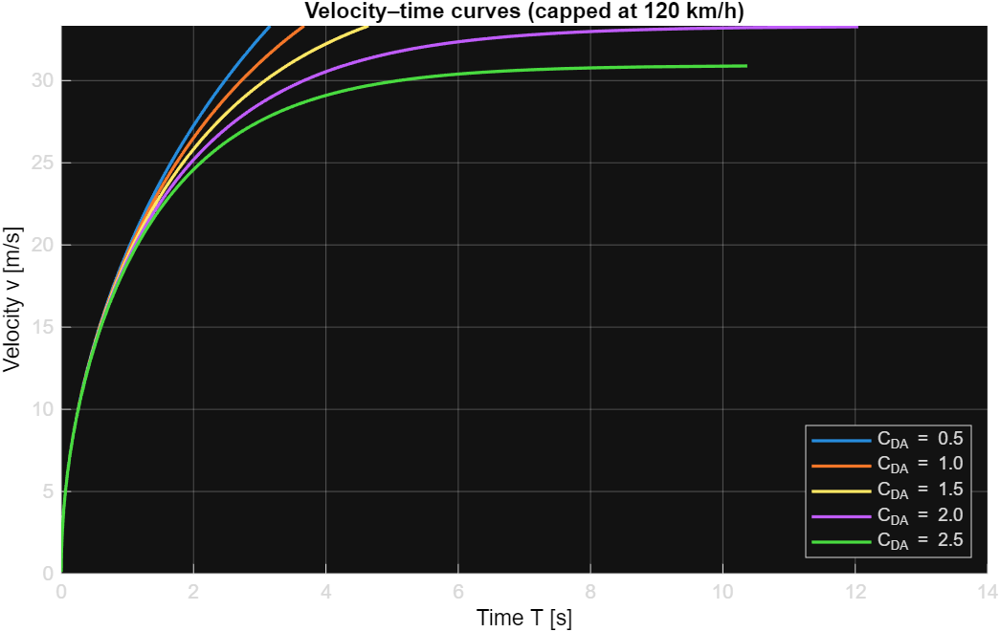 | 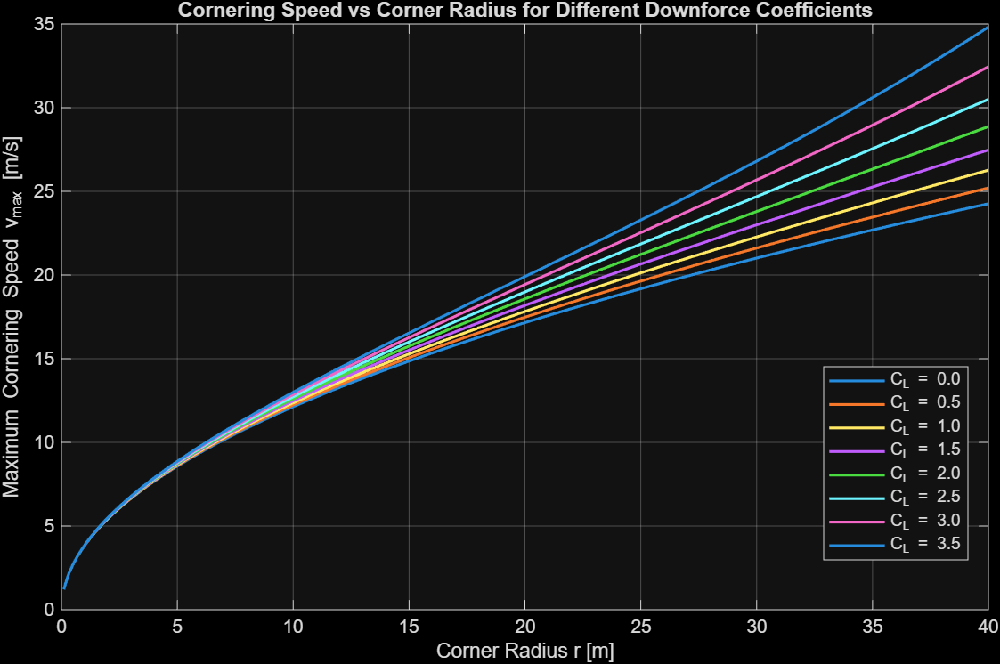 |

*Figures 2–3 — Left: acceleration is almost insensitive to drag across the FSAE speed range; only an
extreme C<sub>D</sub>A = 2.5 m² meaningfully caps top speed. Right: cornering speed rises steadily
with downforce across typical FSAE radii — the benefit being purchased.*

### Rear wing first, front wing to balance

The rear wing sits in a steadier environment and is insensitive to steering, so it is fixed first at
maximum usable downforce. The front wing then supplies the remainder needed to place the centre of
pressure — about **40% of total downforce at the front** — rather than maximising its own force.
Balance is a prescribed input:

```
X_CoP = (F_f x_f + F_r x_r) / (F_f + F_r)                             (5)
```

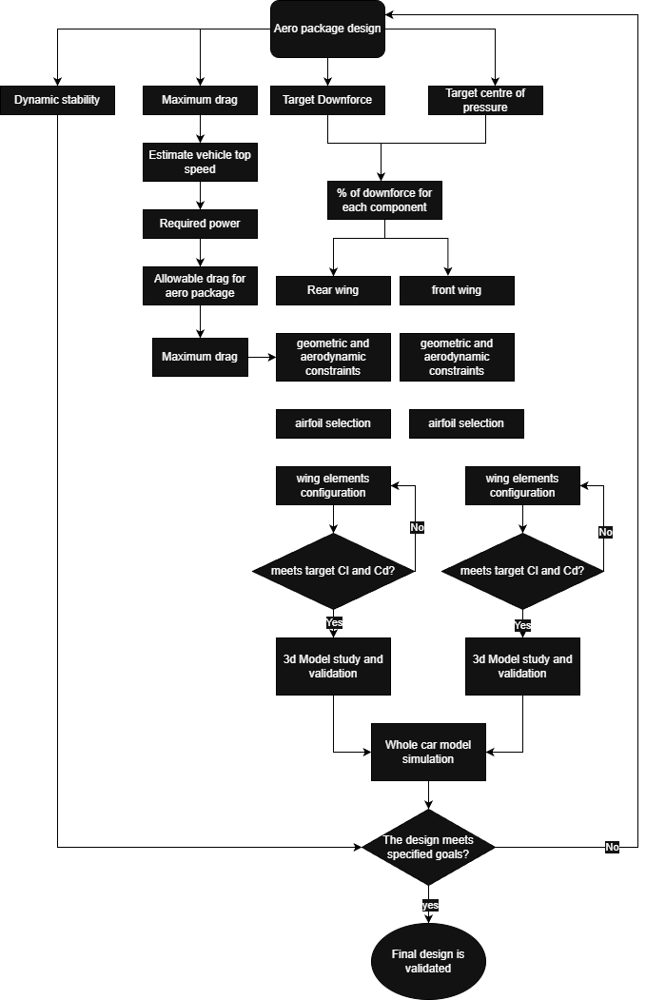

*Figure 4 — Top-down workflow: define targets and constraints → size the rear wing → balance with the
front wing → validate in 3D and against lap time.*

---

## 4. Step 2a — Airfoil screening

Candidates were filtered from the Airfoil Tools database using low-Reynolds-number wing design rules
(McBeath), then retrieved by Python script. A batch framework ran every candidate under identical
conditions:

- **Re = 300,000**, transition forced at **50% chord** on both surfaces
- Angle of attack **−4° to 20°**
- Repeated at panel counts **N = 160 → 300** to check panel dependence
- Polars post-processed in MATLAB

Chord choice is Reynolds-driven: at 16 m/s with c = 0.4 m and ν = 1.4207×10⁻⁵ m²/s,
`Re = Uc/ν ≈ 4.5×10⁵`. A longer chord raises Re, delays separation and softens stall.

**Table — best XFOIL candidates (Re = 300,000)**

| Airfoil | C<sub>L,max</sub> | Stall behaviour | Outcome |
|---|---:|---|---|
| FX74CL5140-IL | 2.29 | Gradual | Highest peak lift |
| **S1223** | **2.23** | **Gradual** | **Selected as starting point** |
| FX74MODSM-IL | 2.12 | Moderate | Reserve |
| E420-IL | 2.10 | More abrupt | Fixed flap section in 2D |
| S1210 12% | 2.05 | Moderate | Not carried forward |

Most candidates peaked between 12° and 14°.

| | |
|---|---|
| 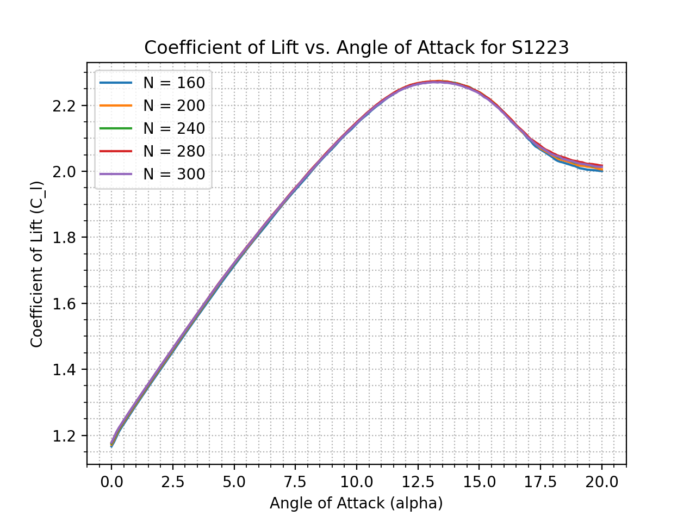 | 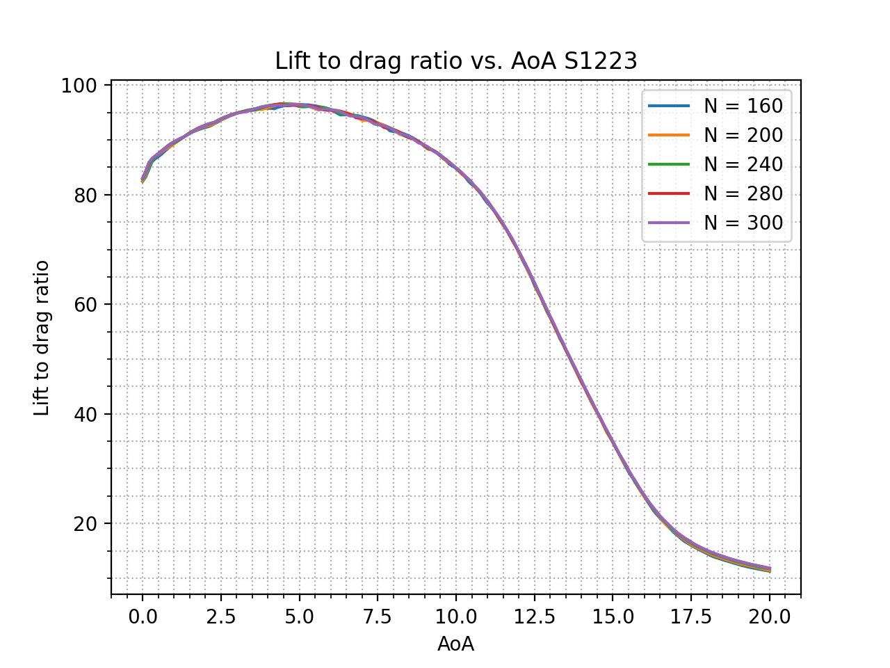 |

*Figures 5–6 — S1223 lift and efficiency curves. The five panel-count runs collapse onto one another:
the result is panel-independent.*

| | |
|---|---|
| 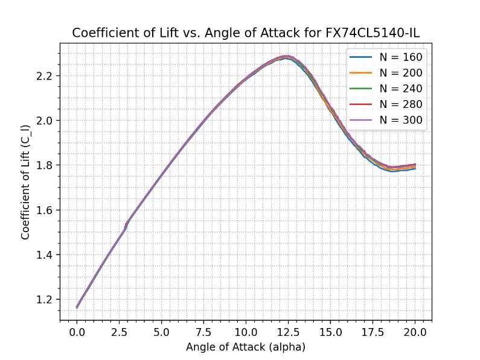 | 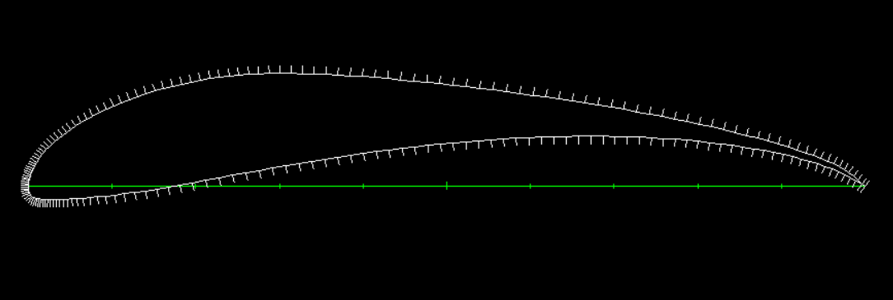 |

*Figures 7–8 — FX74CL5140-IL reaches the highest peak lift (2.29). The S1223 section is heavily
cambered, with the very thin trailing edge that later caused trouble.*

> **Engineering judgement.** S1223 looked best in XFOIL but was **not** adopted directly. XFOIL tends
> to over-predict lift and delay separation, and its thin trailing edge is both a manufacturing risk
> and a poor partner for a slotted multi-element assembly. It was kept as a *starting point* for 2D
> CFD and later customisation — not letting a cheap tool make the final decision.

---

## 5. Step 2b — 2D parametric CFD

The three-element assembly was studied in 2D in **ANSYS Fluent** to isolate how geometry and
incidence drive loading. Fully structured mesh, refined near-field, coarsened far-field, inflation
layers on every element holding **y⁺ < 3**.

| | |
|---|---|
| 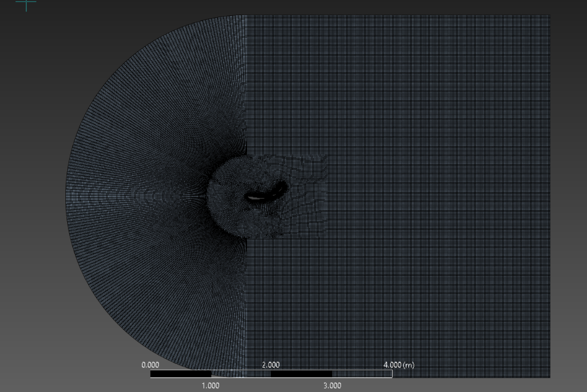 | 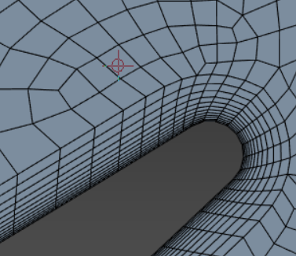 |

*Figures 9–10 — Structured 2D domain and inflation layers at the rounded trailing edge.*

**Design variables.** To keep the comparison clean, **E420-IL was fixed for all flap elements** so
airfoil-to-airfoil variation could not skew the trends. The sweep varied:

- Mainplane chord: **350, 400, 450 mm**
- Flap incidences: α<sub>F1</sub> = 25/30/35°, α<sub>F2</sub> = 55/60/65°
- Slot gap and overlap in a follow-up sweep on the best configuration

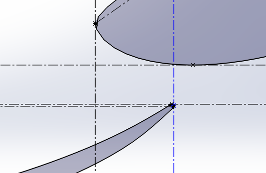

*Figure 11 — Slot gap and overlap. Rotating a flap changes the slot shape and convergence ratio as a
side effect: an intrinsic coupling that had to be accounted for.*

### What the sweep showed

1. **Downforce scales with mainplane chord** — 450 mm best on both force and efficiency.
2. **The mainplane carries 75–80% of the load.** The first flap contributes little and the second
   almost nothing at small chords; real flap suction peaks only appear at c = 450 mm.
3. **α<sub>F1</sub> = 25° is the limit.** Beyond it the first flap separates early: downforce falls,
   drag rises.
4. **Weak flap suction peaks indicated a choked slot jet** — the slot was not feeding enough
   high-energy flow downstream.

| | |
|---|---|
| 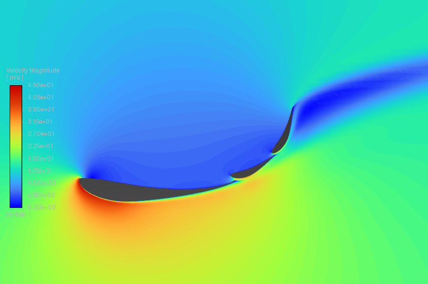 | 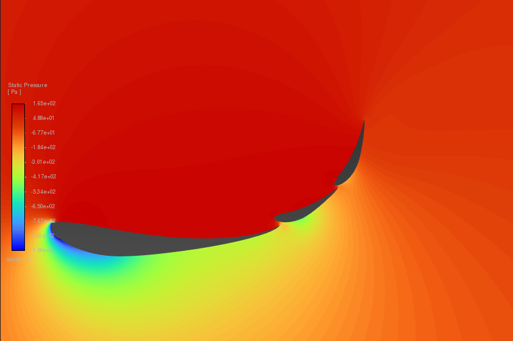 |

*Figures 12–13 — Velocity magnitude and static pressure at c = 450 mm. Slot jets re-energise the
downstream boundary layers; the mainplane suction surface dominates the loading.*

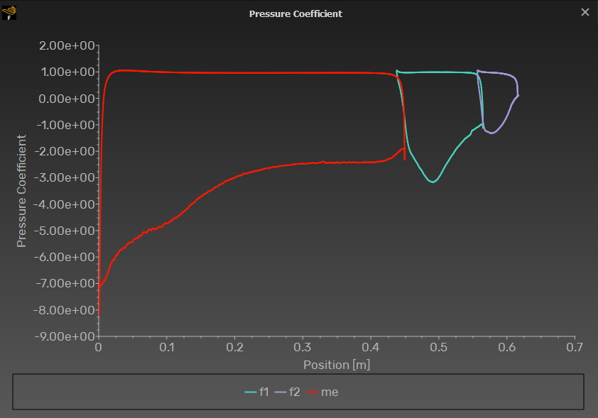

*Figure 14 — C<sub>p</sub> across the three elements. The area under the main-element curve dwarfs the
flaps: the quantitative basis for the 75–80% finding.*

### Fixing the choked slot

Because the second flap showed the weakest suction, its slot gap and overlap were opened first. CFD
confirmed the mechanism — more high-energy air reaches the second element, the boundary layer stays
attached longer, pressure recovery becomes gentler. The 2D force change was small, but the flow-quality
gain was expected to matter more in 3D.

**Table — second-flap slot sweep and pitch-stability check (c = 450 mm, magnitudes)**

| Config | α<sub>ME</sub> | OL2 [mm] | SG2 [mm] | Downforce [N] | Drag [N] | C<sub>L</sub> | C<sub>L</sub>/C<sub>D</sub> |
|---|---:|---:|---:|---:|---:|---:|---:|
| 10 | 0° | 12 | 6 | 369.9 | 10.85 | 5.242 | 34.1 |
| 12 | 0° | 12 | 4 | 369.4 | 10.70 | 5.235 | 34.5 |
| **14** | 0° | 14 | 4 | 371.9 | 10.53 | 5.271 | **35.3** |
| 15 | 0° | 12 | 6 | 375.0 | 10.79 | 5.315 | 34.8 |
| 16 | +2° | 8 | 4 | **380.9** | 11.23 | **5.398** | 33.9 |
| 17 | −2° | 8 | 4 | 355.4 | 9.57 | 5.037 | **37.2** |

Configs 15–17 bracket ±2° of main-element pitch to represent ride-height variation. Peak downforce
(16) and peak efficiency (17) are *different* configurations — choosing between them is a
vehicle-level decision. 2D values are per-unit-span section results, not comparable to 3D forces.

> **Data integrity note.** In the source report, Table 6 configuration 9 repeats the values of
> Table 5 configuration 9 (297.3 N, C<sub>L</sub> = 4.740, C<sub>L</sub>/C<sub>D</sub> = 21.1). It is
> flagged rather than silently corrected, and should be re-checked against the original Fluent case.

---

## 6. Step 2c — Custom airfoils

Catalogue airfoils are optimised for someone else's Reynolds number and duty. With the 2D trends
understood, a Python-based airfoil editor produced purpose-built sections:

1. **Particle swarm optimisation** targeting downforce at low incidence and gentler post-stall behaviour.
2. **Manual Bézier refinement** to enforce trailing-edge thickness and geometric safety limits.

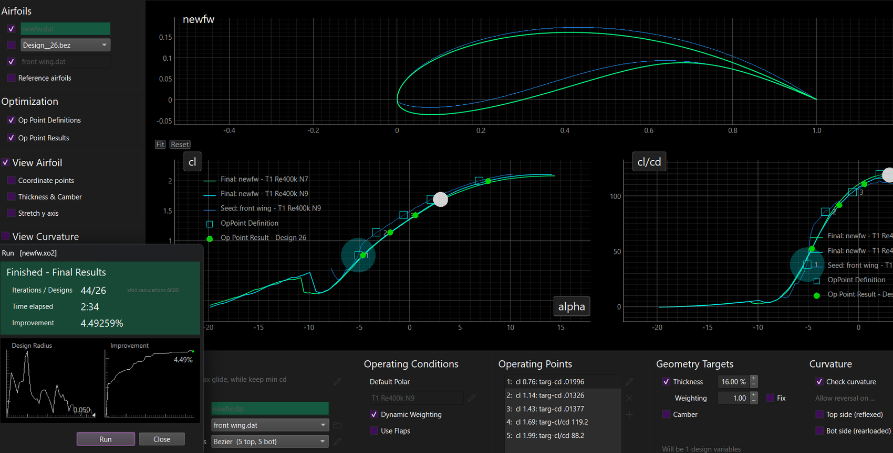

*Figure 15 — The airfoil editor running PSO: shape parameters, operating points and geometry targets
driven together.*

| | |
|---|---|
| 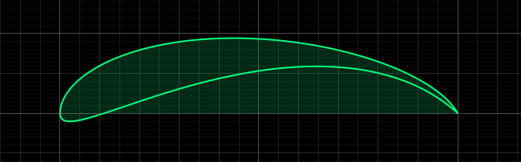 | 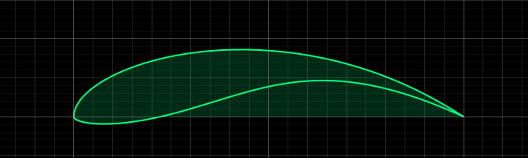 |

*Figures 16–17 — **Custom 3** (rear main element): S1223-derived, camber shifted rearward to move the
suction peak aft, trailing edge thickened for manufacturability. Front-wing main element: high camber
to exploit ground effect, with a straight trailing region conditioning flow for the next element.*

Each element got a section matched to its job. Rear flaps use a thin trailing edge and rounded leading
edge to raise slot convergence. The front-wing first flap is strongly rear-cambered so it turns flow
parallel to the second flap's leading edge — because on a front wing, **the wake sent downstream
matters as much as the force generated**.

---

## 7. Step 3a — 3D wing, endplates, mounts

Only configurations already efficient in 2D reached this stage. The isolated rear wing was run in
**SimScale** with **k–ω SST** and a near-wall mesh targeting **y⁺ < 1**.

| Boundary | Placement | Reason |
|---|---|---|
| Inlet | 3 c upstream | Let the incoming flow develop |
| Outlet | 8 c downstream | Room for the wake to develop and dissipate |
| Upper & lateral | 3 c from wing | Limit blockage and boundary interaction |
| Turbulence | k–ω SST | k–ω near wall, k–ε in free stream; good under adverse gradients |
| Near-wall | y⁺ < 1 | Resolve wall shear stress rather than model it |
| Mesh | Unstructured, refined at surfaces and wake | Conform to high-curvature edges |

| | |
|---|---|
| 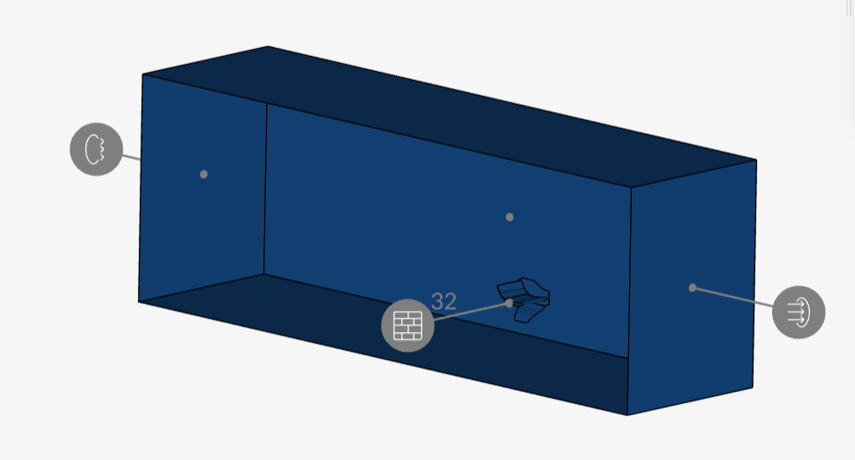 | 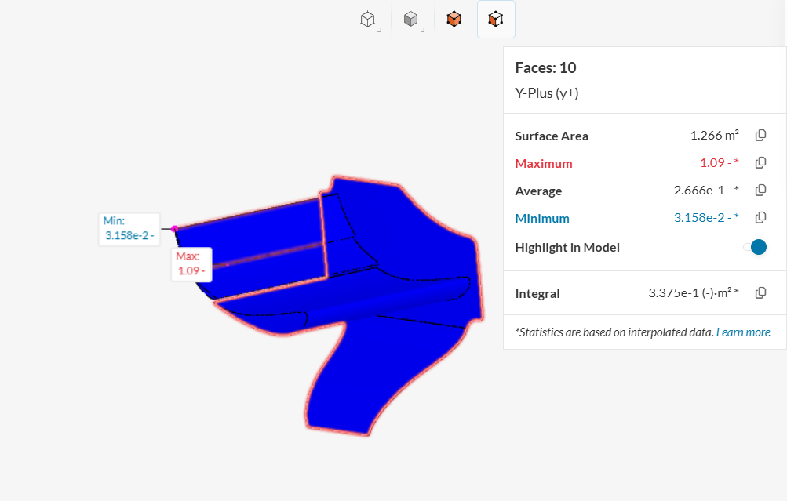 |

*Figures 18–19 — Isolated-wing domain sized in chord lengths, and the wall y⁺ map verifying the
near-wall target across the surfaces rather than assuming it.*

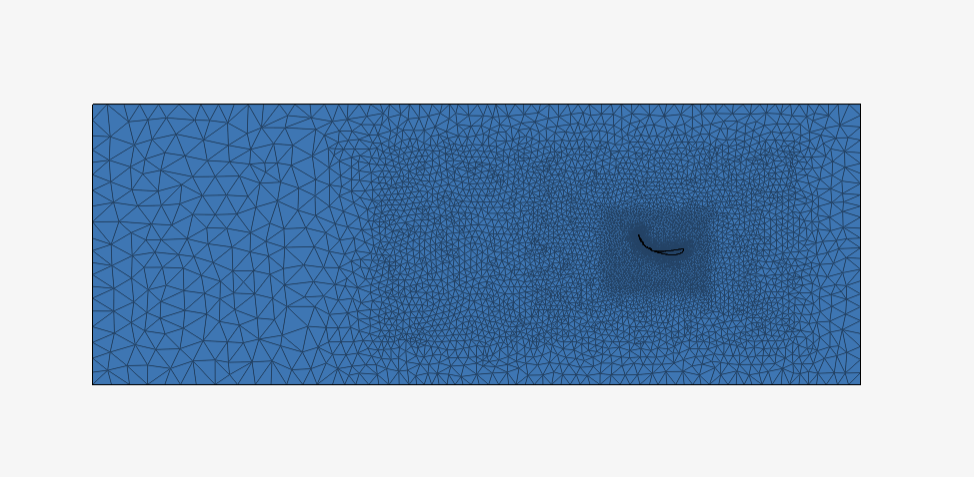

*Figure 20 — Surface and wake refinement resolving separation and the turbulent wake.*

### Endplates: deeper is not automatically better

Endplates sustain the pressure difference by blocking tip spillage. First-order, they raise effective
aspect ratio (Hoerner):

```
AR_eff = AR_actual (1 + 1.9 h/b)                                      (6)
```

But that suggests "deeper is always better", and published CFD (McBeath) says otherwise: an
intermediate depth can outperform a much deeper plate, because the vortex curling under the bottom
edge energises the flow beneath the suction surface. Depth is therefore treated as a parameter to
**optimise, not maximise** — which also saves weight and lowers the centre of gravity.

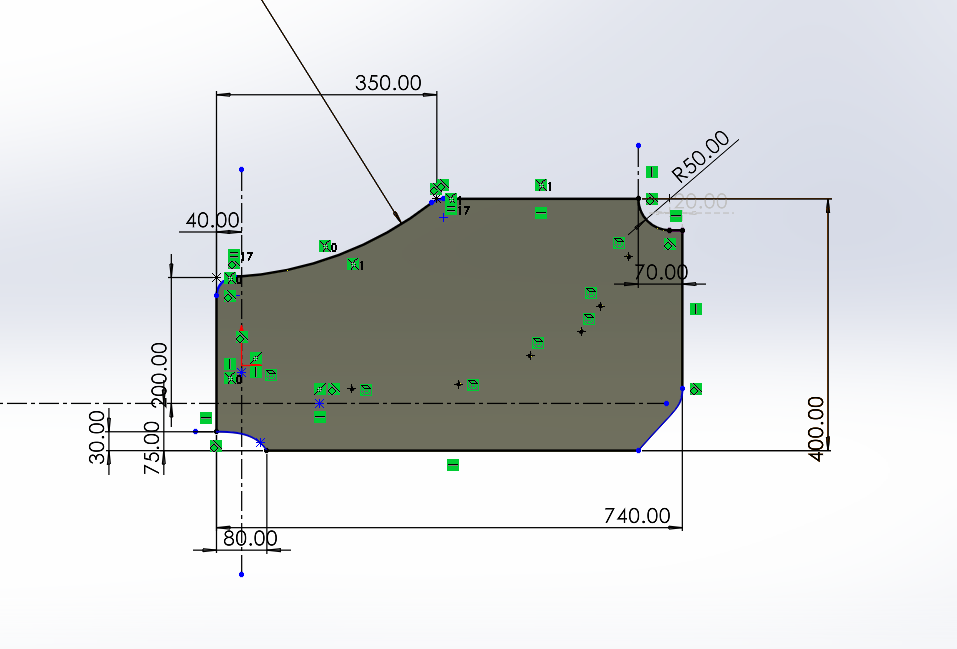

*Figure 21 — Parametrised endplate (mm), extended downwards to double as a structural support.*

> **Swan-neck mounts.** On an inverted wing the **lower surface is the suction surface** — the most
> sensitive region. A conventional underside mount sits in that high-velocity flow and can trigger
> premature separation. Top-mounted swan-neck supports move the obstruction to the pressure side.

### Standard vs custom sections in 3D

| Main element | Flaps | α<sub>ME</sub>/α<sub>F1</sub>/α<sub>F2</sub> | C<sub>L</sub> | C<sub>D</sub> | Efficiency |
|---|---|---|---:|---:|---:|
| Custom 1 | Custom 2 | 0/35/58° | 3.09 | 0.97 | 3.186 |
| **S1223** | FX 63-137 | 0/35/60° | 3.47 | 1.08 | **3.212** |
| Custom 3 | FX 63-137 | 0/40/65° | 3.73 | 1.29 | 2.890 |
| Custom 3 | FX 63-137 | 0/35/60° | 3.54 | 1.11 | 3.190 |
| Custom 3 | Custom 4 | 0/35/60° | 3.69 | 1.24 | 2.980 |
| Custom 3 | Custom 4 + Gurney | 0/35/60° | **4.12** | 1.57 | 2.622 |

The Gurney flap buys the most downforce at the worst efficiency. Because Step 1 proved drag is
affordable, that trade is acceptable here — **the ranking depends entirely on the drag budget
established at the start**.

| | |
|---|---|
| 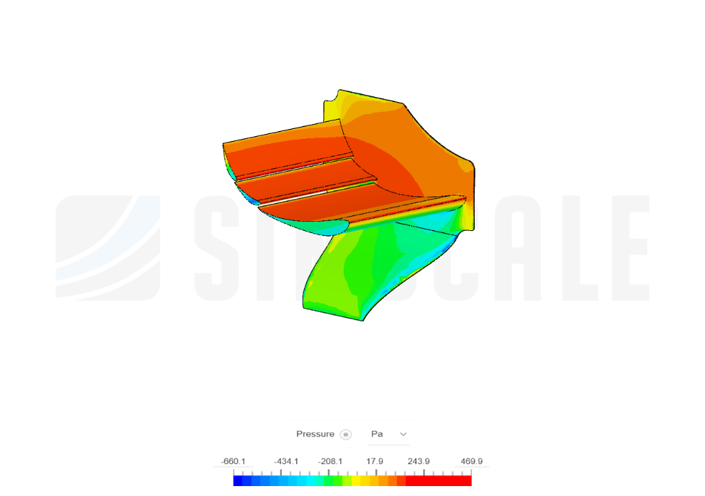 | 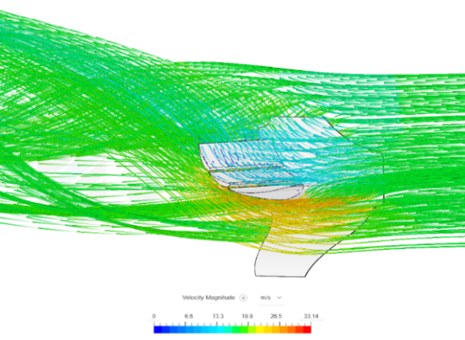 |

*Figures 22–23 — 3D pressure field including endplate effects, and streamlines showing the tip vortex
and wake structure that no 2D run can reveal.*

---

## 8. Step 3b — Full-vehicle CFD

An isolated wing number means little on a car. The geometry was prepared by simplifying components
**without changing their aerodynamic character** — a spring becomes a cylinder, not a deletion — so
the model converges faster while still representing the real flow. Body, wings, suspension arms and
springs, tyres and uprights, rear axle and differential, radiator and driver were retained.

| | |
|---|---|
| 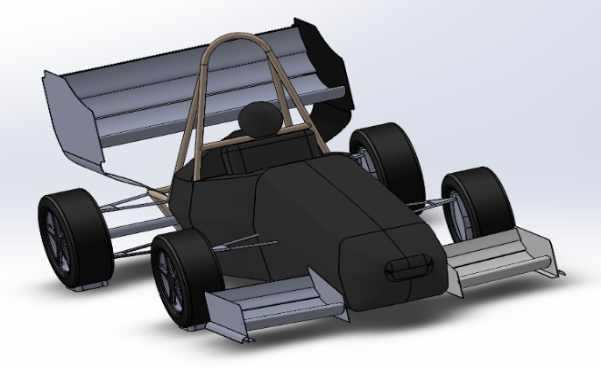 | 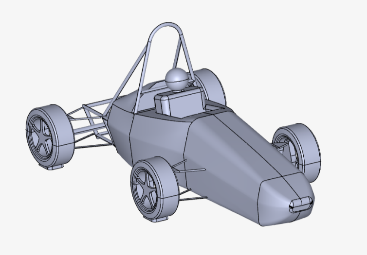 |

*Figures 24–25 — Prepared full-car geometry with wings, and the baseline without aero devices.*

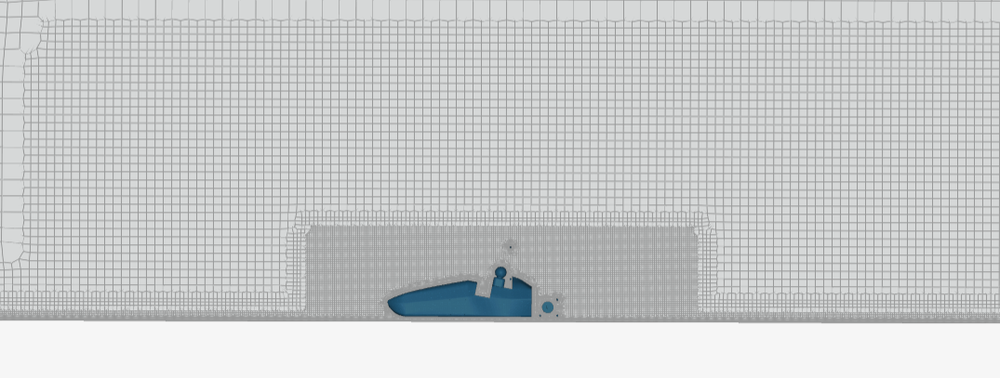

*Figure 26 — Wind-tunnel domain mesh with local refinement around the vehicle.*

The baseline returned **C<sub>D</sub> ≈ 0.645** and essentially zero lift
(**C<sub>L</sub> ≈ 0.0048**) — plausible for a car with no aerodynamic devices. Both later
configurations ran under **identical wind-tunnel conditions**, so differences are attributable to
geometry alone.

| | |
|---|---|
| 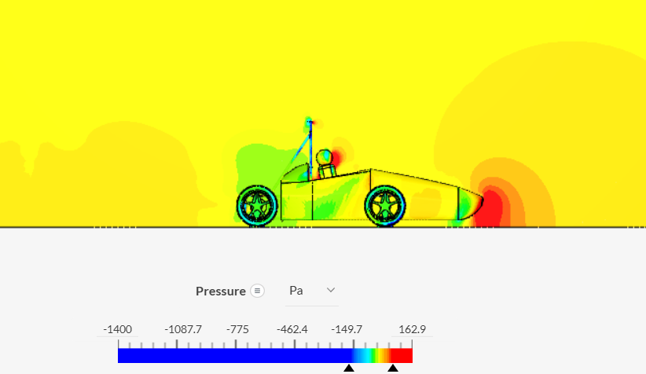 | 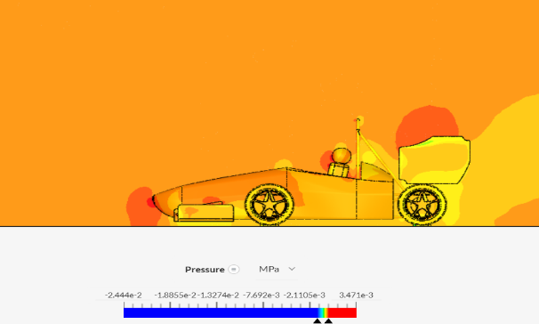 |

*Figures 27–28 — Baseline pressure field, and with wings fitted: the suction regions under both wings
become the dominant feature.*

> **Result.** With front and rear wings: **460 N downforce for 296 N drag**
> (C<sub>L</sub> = 2.69, C<sub>D</sub> = 1.73, C<sub>L</sub>/C<sub>D</sub> = 1.555). Drag rises ~2.7×
> over baseline — a large penalty, and exactly the one the Step 1 budget said was affordable.

---

## 9. Step 4 — Underbody devices

The chassis would not accept a full-width Venturi floor without redesign. Two additions were tested
on the existing bodywork instead:

- **Side diffusers** — lateral ramps expanding the flow along the lower sides.
- **Underbody walls** — vertical plates restricting lateral exchange between the low-pressure
  underbody region and the surrounding flow.

A diffuser is not automatically a gain: pressure recovery creates an adverse gradient, and if the
boundary layer cannot survive it the flow separates and the device stops working. The walls can add
drag or leak at their ends. Both effects had to be measured, so the car *with wings* became the new
baseline under the same conditions.

| | |
|---|---|
| 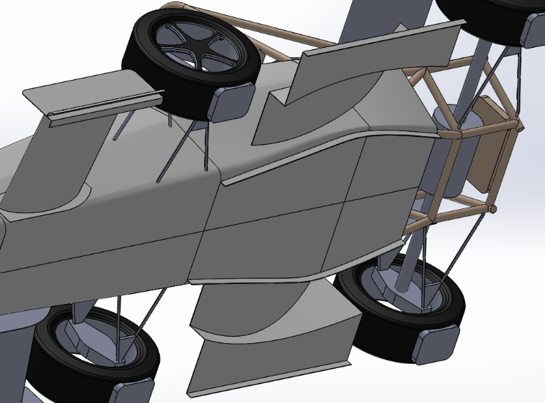 | 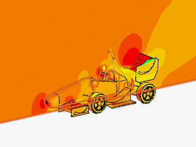 |

*Figures 29–30 — The lateral ramp and sealing wall working together, and the midplane flow field with
the full package.*

**Table — full-vehicle force coefficients (CFD, magnitudes)**

| Configuration | C<sub>L</sub> | C<sub>D</sub> | C<sub>L</sub>/C<sub>D</sub> | Change |
|---|---:|---:|---:|---|
| Baseline — no aero devices | 0.005 | 0.645 | — | Reference |
| Front and rear wings | 2.69 | 1.73 | 1.56 | Downforce bought with drag |
| **+ side diffusers + underbody walls** | **3.35** | **1.70** | **1.97** | **+25% C<sub>L</sub> at no drag cost** |

> **What this does not separate.** The diffuser and wall contributions were **not tested
> independently**, and their sensitivity to ride height, pitch and roll was not assessed. The +25% is
> a combined effect for this geometry at this attitude.

---

## 10. Rear-wing structure

The wing must pass the rulebook deflection tests while staying light. Two rib-and-spar architectures
were developed:

- **Design 1** — six ribs (two outboard, four central); the four central ribs carry attachment lugs so
  each mount bolts to two ribs.
- **Design 2** — two central ribs; each mount fastens to a single larger rib with two parallel lugs.

| | |
|---|---|
| 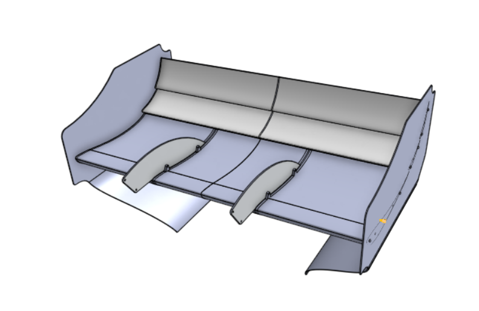 | 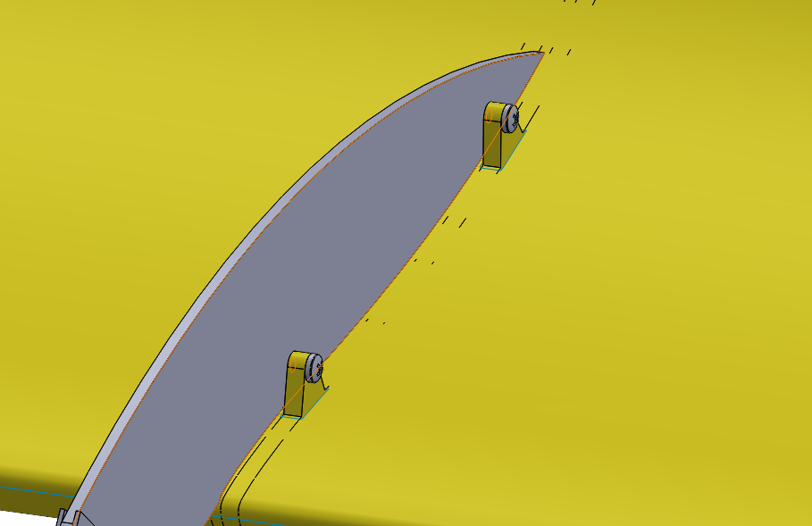 |

*Figures 31–32 — Design 1 internal structure with ribs and longitudinal bars, and the swan-neck mount
fastened into the central ribs, keeping the suction surface clear.*

Selecting between them requires running the 200 N / 10 mm and 50 N / 25 mm tests on the actual
laminate — listed under next steps rather than claimed as done.

---

## 11. Lap-time simulation

Force coefficients are not a result until converted into something the car does. The three
configurations were run through **OptimumLap** (quasi-steady-state, point-mass) on the **Formula
Student Germany 2012 endurance track** at Hockenheim — ~1.4 km with slow, medium and fast corners plus
two long straights. Only C<sub>D</sub> and C<sub>L</sub> change between runs; mass, tyre friction and
powertrain are identical.

**Aerodynamic inputs as entered (rounded CFD values)**

| Configuration | C<sub>D</sub> | C<sub>L</sub> |
|---|---:|---:|
| 1 · Baseline | 0.65 | 0.006 |
| 2 · Wings | 1.73 | 2.70 |
| 3 · Full package | 1.71 | 3.35 |

**Simulated lap times**

| Configuration | Lap [s] | Gain [s] | Gain [%] | Max lateral acc. [m/s²] |
|---|---:|---:|---:|---:|
| 1 · Baseline | 86.71 | — | — | ≈14.7 |
| 2 · Wings | 85.06 | 1.65 | 1.9 | ≈16.6 |
| **3 · Full package** | **84.59** | **2.12** | **2.4** | **≈17.0** |

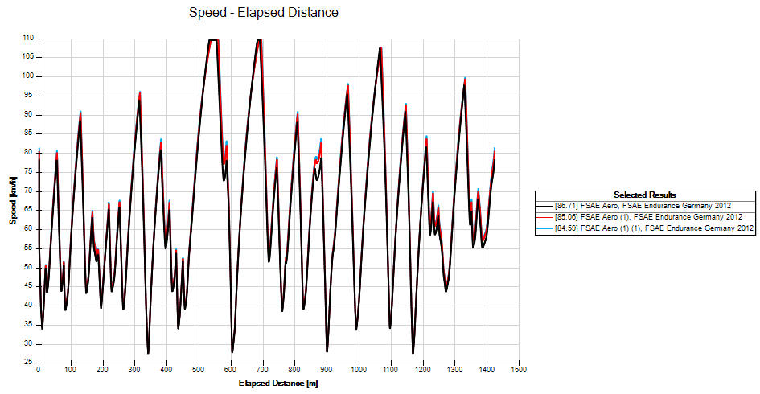

*Figure 33 — Speed along the lap (black: baseline, red: wings, blue: full package). Traces separate in
medium and fast corners and coincide in the slowest ones.*

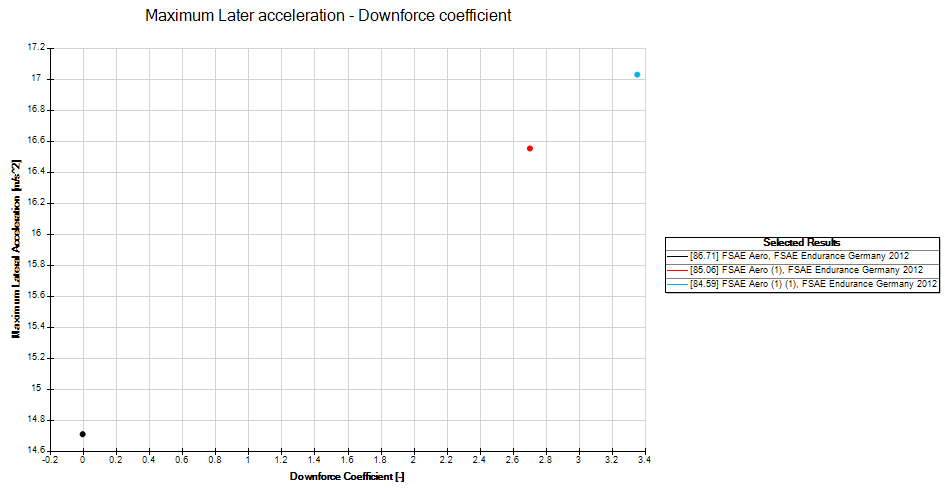

*Figure 34 — Peak lateral acceleration rises from ≈14.7 m/s² (1.5 g) to ≈17.0 m/s² — about +16%.*

### Three findings

1. **The package works.** Wings gain 1.65 s; underbody devices add 0.47 s more → **2.12 s (2.4%)**.
2. **The gain is in the corners.** Below ~28 km/h the traces coincide — downforce grows with v², so it
   does nothing in the slowest turns. In medium and fast corners the aero cars carry 2–3 km/h more.
3. **The drag penalty never appears.** All three reach the same 110 km/h ceiling on both straights,
   despite ~2.7× the drag coefficient.

The upgrades also differ in *efficiency of gain*: wings add 2.7 of C<sub>L</sub> for 1.65 s
(≈0.6 s per unit), while the underbody devices add 0.65 for 0.47 s (≈0.7 s per unit) because they raise
downforce without raising drag. That identifies the lower bodywork as the better place for the next
increment.

> **Scope of the lap simulation.** OptimumLap is point-mass and quasi-steady-state. It uses a
> **constant tyre friction coefficient with no load sensitivity**, and does not model suspension,
> weight transfer, aero balance, or the effect of ride height, pitch and yaw on the coefficients. The
> driver is ideal, the powertrain is a typical FSAE car rather than the intended engine, and the track
> is a reference layout, not one of the team's events. Absolute lap times must not be compared with
> real competition times. Because real tyres lose grip per unit load as load grows, **real gains are
> likely smaller**. Device mass is not included, so these are gross gains.

---

## 12. Limitations and next steps

### Known limitations

- Full-car geometry used non-final components, so absolute values are indicative.
- XFOIL and 2D CFD are screening tools; tip vortices and front-wing wake interaction only appear in 3D.
- Side-diffuser and underbody-wall contributions were not separated.
- Underbody sensitivity to ride height, pitch and roll was not assessed.
- No wind-tunnel or on-track validation; compute resources limited model detail.
- Lap simulation uses constant tyre friction and a generic powertrain.

### Next steps

- Re-run lap simulation with measured engine data, a load-sensitive tyre model and the mass of the
  aero devices; test sensitivity to the tyre friction coefficient.
- Check full-car drag against the 28.4 kW budget at the speeds the car will actually run.
- Separate diffuser and wall effects; map sensitivity to ride height, pitch, roll and yaw.
- Choose between the two rear-wing structures and verify against the rulebook load tests.
- Plan physical validation of the final package.

---

## 13. Tools and references

| Tool | Use in this study |
|---|---|
| XFOIL | 2D screening of 24 candidates at Re = 300,000, N = 160–300 |
| Airfoil Tools | Airfoil coordinate and performance database |
| Python | Coordinate retrieval, batch XFOIL automation, custom airfoil editing |
| AirfoilEditor | Shape editing and particle swarm optimisation |
| MATLAB | Post-processing of XFOIL polars |
| ANSYS Fluent | 2D parametric CFD: chord, flap angles, slot gap, overlap |
| SimScale | 3D CFD: isolated wing, baseline car, wings, full package |
| CAD | Wing, endplate and mount geometry; car simplification |
| OptimumLap | Quasi-steady-state lap-time simulation |
| LaTeX | The 53-page technical report |

**Key references**

- S. McBeath, *Competition Car Aerodynamics* — the rear-wing-first method and wing design rules.
- S. Wordley & J. Saunders, *Aerodynamics for Formula SAE: Initial design and performance prediction*, SAE 2006-01-0806 — the traction-limited argument.
- J. Katz, *Race Car Aerodynamics*; and *Aerodynamics of race cars*, Annu. Rev. Fluid Mech. 38 (2006) 27–63.
- K. R. Cooper et al., *The aerodynamic performance of automotive underbody diffusers*, SAE 980030.
- A. Ruhrmann & X. Zhang, *Influence of diffuser angle on a bluff body in ground effect*, J. Fluids Eng. 125(2) (2003) 332–338.
- C. Chatpattanasiri et al., *Numerical study and design of side-diffusers for Formula-SAE car*, JRAME 10(1) (2022).
- S. F. Hoerner & H. V. Borst, *Fluid-Dynamic Lift* — effective aspect ratio with endplates.
- I. H. Abbott & A. E. von Doenhoff, *Theory of Wing Sections*.

---

## Figures and permissions

All figures on this page are from my own analyses in the project report. Third-party images used in
the report for literature review (other teams' cars, rulebook diagrams, published figures) are **not**
republished here. The full report is not distributed publicly; this page is a summary cleared for
sharing.

**Team context:** ENP Racing Team represented Algeria at Formula Student UK and received the
**Newcomers Award**. This work was carried out as part of a student team project; the aerodynamic
development and report described here are my own contribution.

**[→ Web case study](../formula-student.html)** · **[→ Riyah](../riyah-hawt-design/README.md)** · **[→ Portfolio](../../README.md)**
