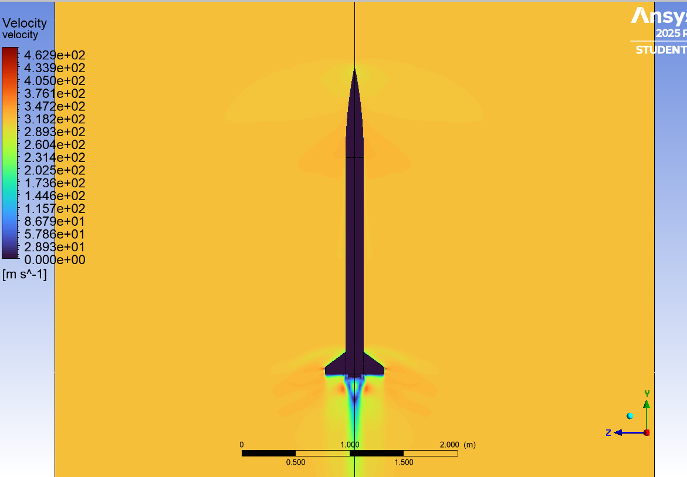
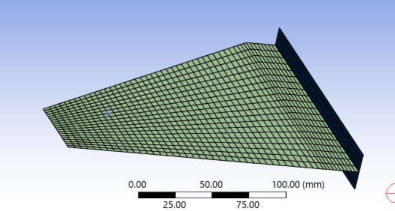
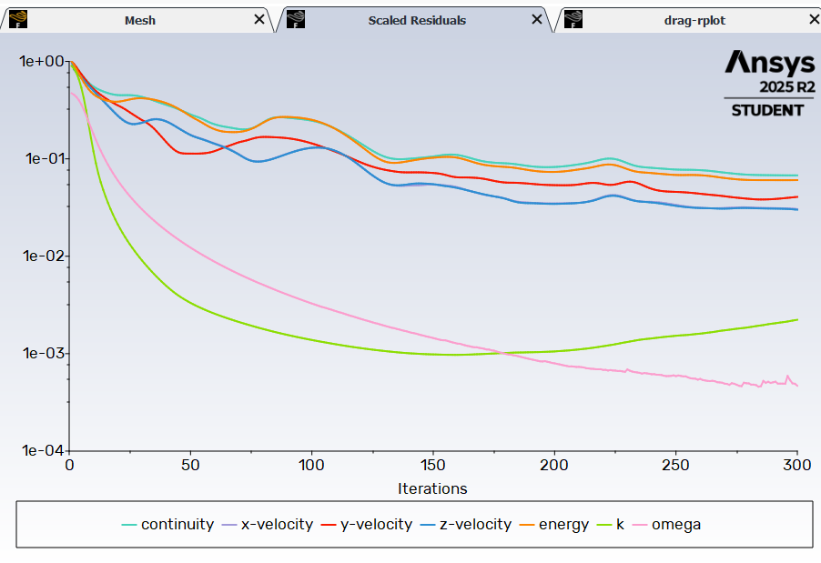
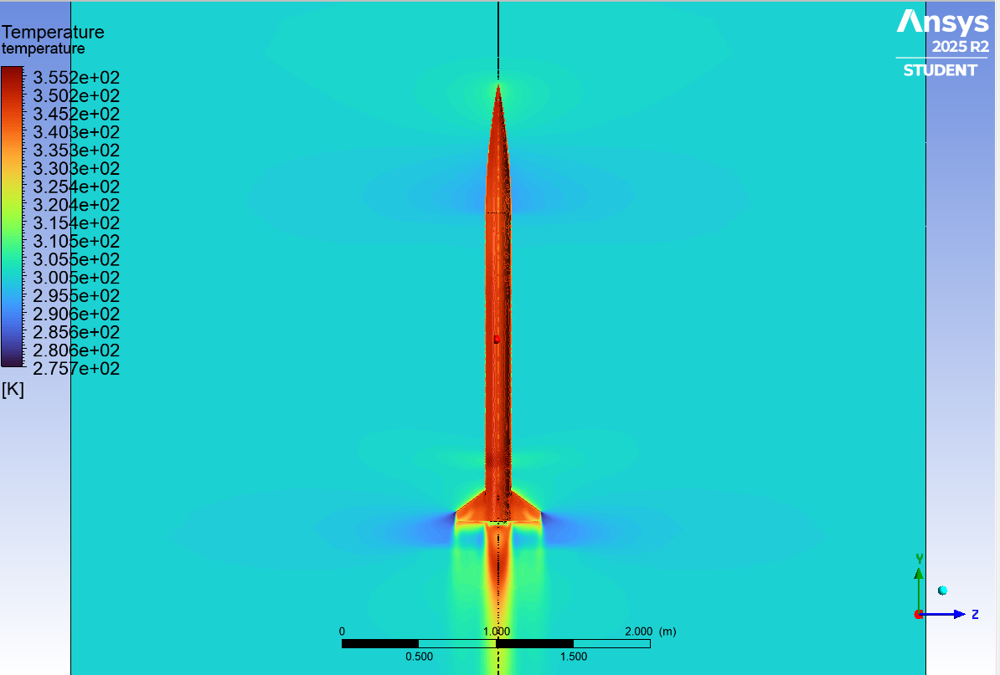
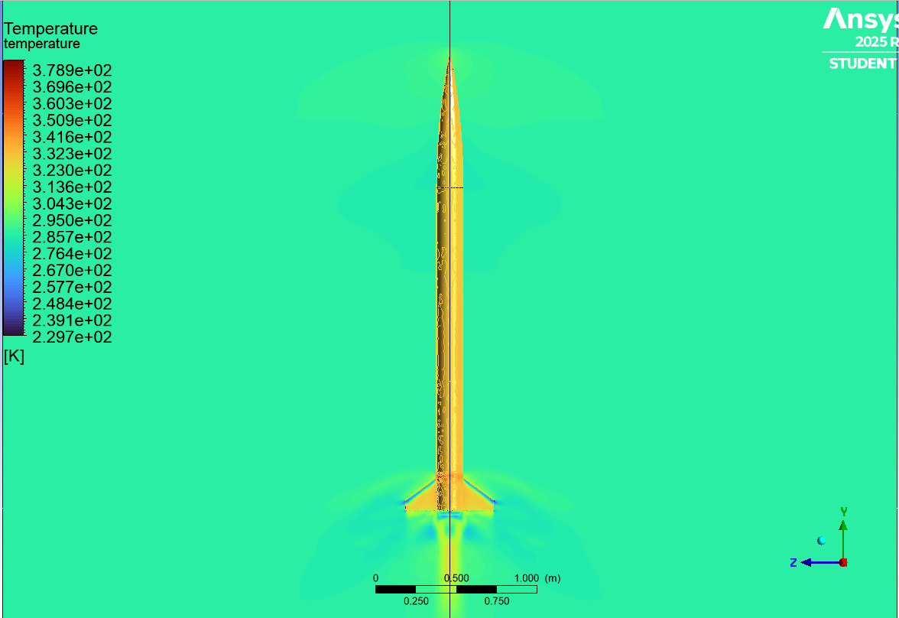
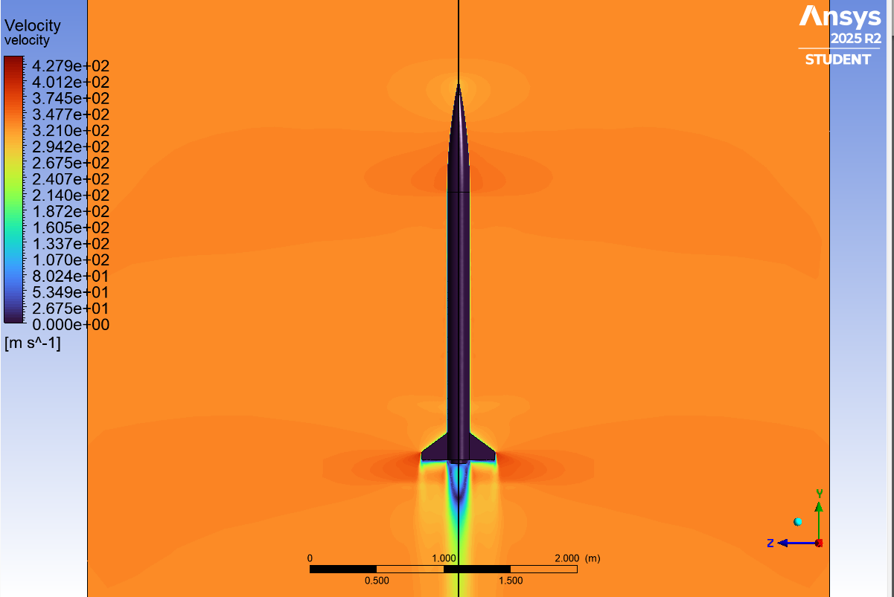

# Rocket V1: Fin Structural (FEA) & Flight Aerodynamics (CFD)

Finite-element and CFD analysis of the V1 composite fin design at the point of **maximum aerodynamic loading** (peak ascent velocity, Mach 0.93).

   

  
  

## Summary

| | |
|---|---|
| **Goal** | Verify the fins resist bending without excessive deformation or failure, and characterise the flow around the full rocket at peak velocity |
| **Tools** | SolidWorks, ANSYS Workbench (Mechanical, ACP), ANSYS Fluent |
| **Structural method** | Thin-shell composite sandwich, static structural analysis |
| **CFD method** | 3D compressible external flow, quarter domain with symmetry, pressure far-field, k–ω SST |
| **Key result** | Peak von Mises stress **9.98 MPa** vs. estimated allowable **≈ 13.4 MPa** |

---

## 1. Structural analysis of the fins

### Modelling approach
The fins are modelled as a **thin shell**. In SolidWorks I extracted the midplanes of the fin faces and root so the whole composite stack is represented by a single surface. This keeps the model cheap while capturing the bending behaviour that matters.

### Composite layup
Symmetric stack-up built in ACP:

| Layer | Material | Orientation |
|---|---|---|
| Core | Wood, 3 mm | 0° |
| Skin 1 | Glass fibre 500 g/m² | 0° |
| Skin 2 | Glass fibre 500 g/m² | 45° |
| Skin 3 | Glass fibre 240 g/m² | 90° |

The skin layers are mirrored on the other side of the core. The two heavy plies carry the load; the 240 g/m² outer ply gives surface finish and extra reinforcement. Material properties were taken from the fibre datasheets and entered in ANSYS Engineering Data.

  
  

### FE setup
- **Mesh:** shell elements, refined at the fin root and edges
- **Boundary conditions:** fixed support at the fin root (attachment to the body)
- **Loads:** aerodynamic force on the fin surfaces, supplied by the flight dynamics team
- **Solver:** static structural

### Results

- **Maximum equivalent (von Mises) stress: 9.98 MPa**
- Estimated allowable stress for the composite: **≈ 13.4 MPa**
- Stress peaks at the **fin root**, as expected from the transmitted bending moment
- The layup and geometry are structurally adequate for the applied loading

---

## 2. Flight simulation (CFD)

### Geometry and domain
- Full 3D rocket: nose cone, body tube, fin assembly
- Nose tip **slightly rounded** to avoid degenerate mesh elements; negligible aerodynamic effect at this Mach number
- Large enclosure subtracted (Boolean) to give the fluid domain, sized so shocks dissipate before the boundaries and the wake develops fully
- **Quarter domain** with symmetry planes to cut computational cost

### Boundary conditions
A **Pressure Far-Field** boundary for compressible external flow, with static pressure and temperature from standard-atmosphere values at the flight altitude.

| Parameter | Value |
|---|---|
| Mach number | 0.93 |
| Gauge pressure | 98078 Pa |
| Turbulence intensity | 5 % |
| Turbulent viscosity ratio | 10 |

### Solver setup
- **Density-based** solver (compressible, high-speed external flow), with a **pressure-based** run for comparison
- **k–ω SST** turbulence model
- **Energy equation on**

### Convergence
- Scaled residuals below **1×10⁻⁵** on continuity and energy
- A **drag report** on the rocket body had to reach a stable plateau, so convergence was checked on residuals and on a physical quantity

### Results: pressure-based vs density-based

| | Pressure-based | Density-based |
|---|---|---|
| **Temperature** |  |  |
| **Pressure** |  |  |
| **Velocity** |  |  |

---

## Limitations and next steps
- Thin-shell idealisation ignores through-thickness effects (delamination, core shear)
- Static equivalent load; no aeroelastic (flutter) solve, only a bending-strength check
- 13.4 MPa allowable is an estimate; replace with a composite failure criterion (Tsai-Wu / Hashin) and validate with coupon tests
- No mesh-independence study included
- CFD loads not yet coupled to the FE model (one-way FSI is the next step)

Full write-up: [report.docx](report.docx)

[← Back to all rockets](../README.md)
