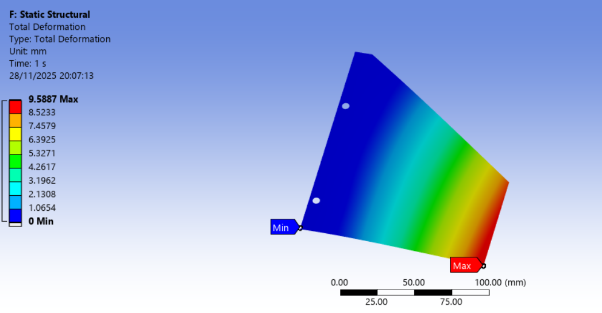
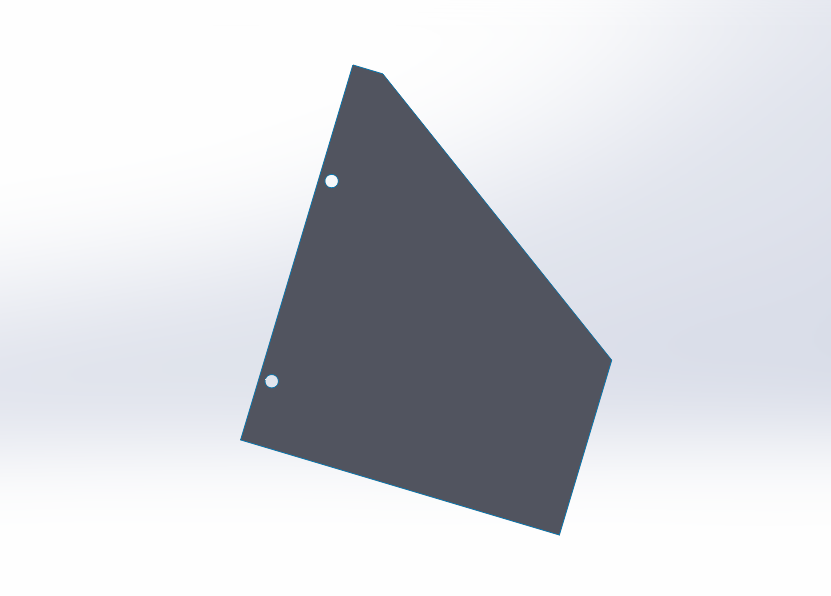
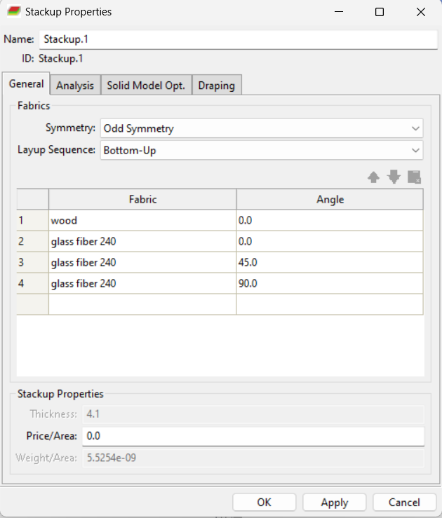
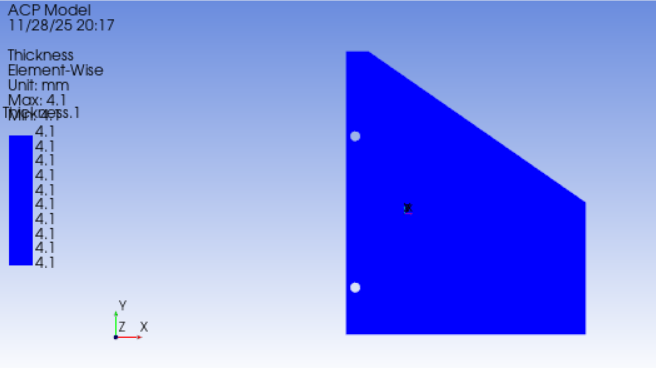
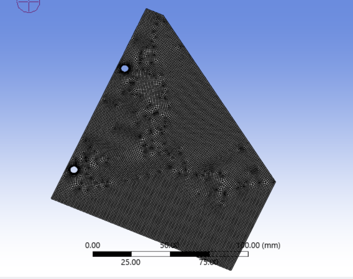
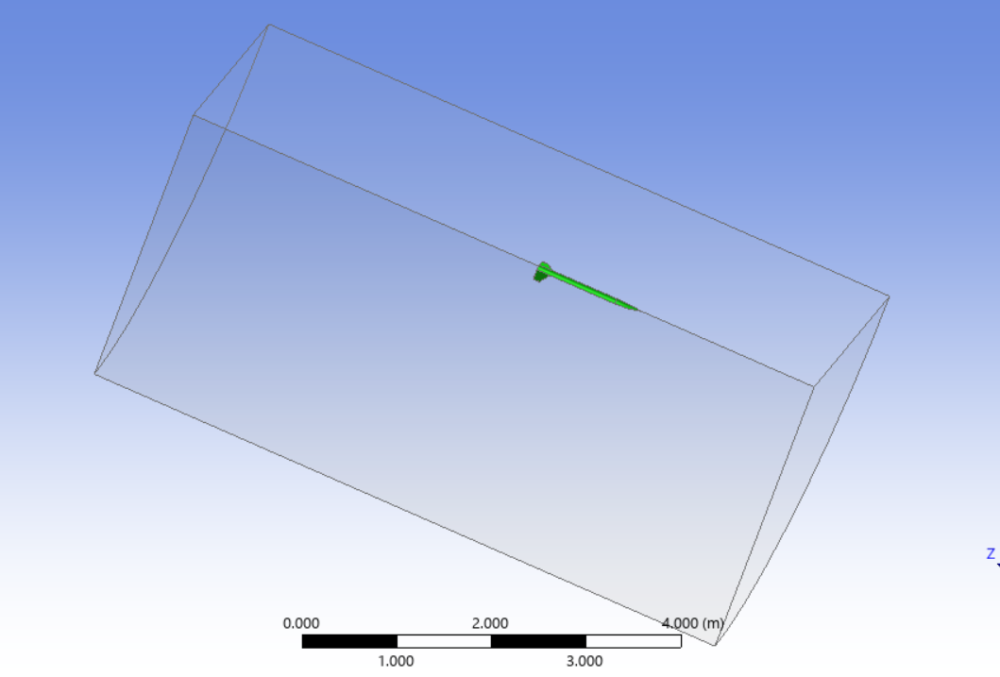
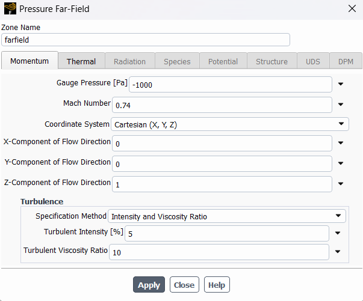
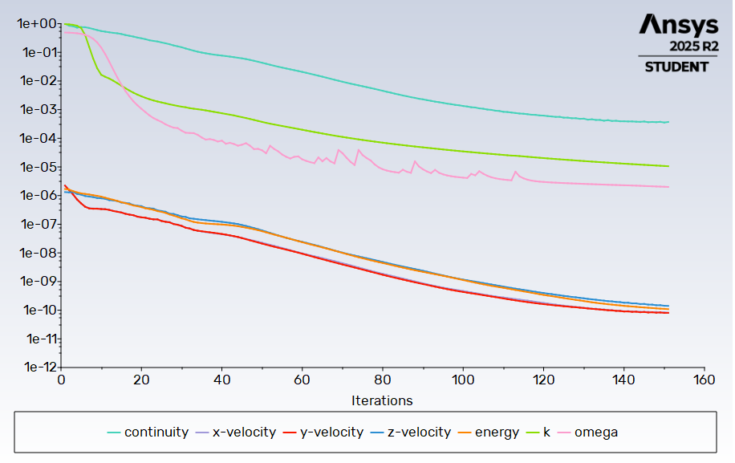
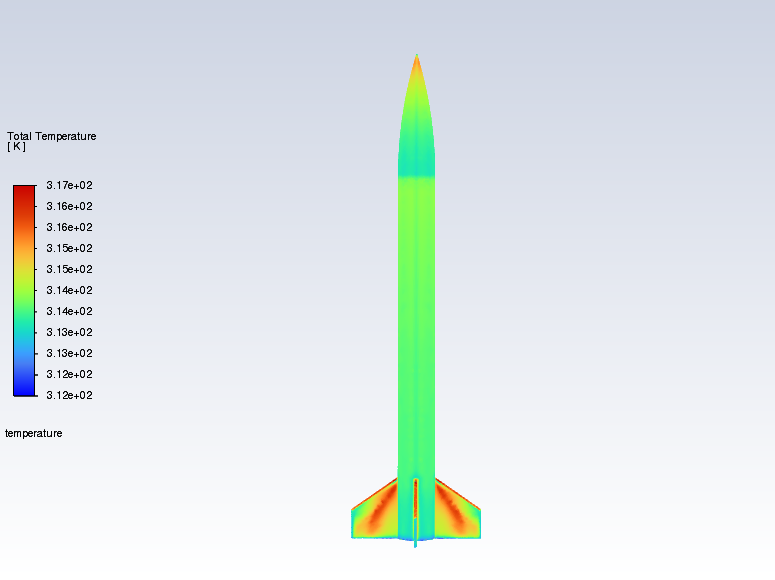

# Rocket V2: Fin Structural (FEA) & Flight Aerodynamics (CFD)

Second design iteration: a lighter composite fin with mounting holes, analysed at a peak-velocity condition of Mach 0.74.

    

  
  

## Summary

| | |
|---|---|
| **Goal** | Check a lighter fin layup with mounting holes against aerodynamic bending loads, and characterise the flow around the full rocket |
| **Tools** | SolidWorks, ANSYS Workbench (Mechanical, ACP), ANSYS Fluent |
| **Structural method** | Thin-shell composite sandwich, static structural analysis |
| **CFD method** | 3D compressible external flow, quarter domain with symmetry, pressure far-field, k–ω SST |
| **Structural result** | Peak von Mises stress **875.42 MPa**, max deflection **9.59 mm** (located at the lower mounting hole) |

> **Status:** the structural result is far above the ≈ 13.4 MPa allowable used for [V1](../rocket-v1/README.md), so this design is **not validated**. See *Limitations and next steps*.

---

## 1. Structural analysis of the fins

### Modelling approach
Thin-shell model: midplanes of the fin faces and root extracted in SolidWorks so the composite stack is a single surface. The fin includes two mounting holes.

### Composite layup
Symmetric stack-up built in ACP:

| Layer | Material | Orientation |
|---|---|---|
| Core | Wood, 2 mm | 0° |
| Skin 1 | Glass fibre 240 g/m² | 0° |
| Skin 2 | Glass fibre 240 g/m² | 45° |
| Skin 3 | Glass fibre 240 g/m² | 90° |

Skins are mirrored on the other side of the core. Total thickness in ACP: **4.1 mm**. Material properties were taken from the fibre datasheets and entered in ANSYS Engineering Data.

  
  

### FE setup
- **Mesh:** shell elements, refined at the fin root and edges (and around the holes)
- **Boundary conditions:** supports at the fin root, representing attachment to the body
- **Loads:** aerodynamic force on the fin surfaces, supplied by the flight dynamics team
- **Solver:** static structural

### Results

  
  

- **Maximum equivalent (von Mises) stress: 875.42 MPa**, at the lower mounting hole
- **Maximum total deformation: 9.59 mm**, at the fin tip

---

## 2. Flight simulation (CFD)

### Geometry and domain
- Full 3D rocket: nose cone, body tube, fin assembly
- Nose tip **slightly rounded** for mesh quality and solver stability
- Large enclosure subtracted (Boolean) to give the fluid domain, with room for the wake to develop
- **Quarter domain** with symmetry planes

### Boundary conditions
**Pressure Far-Field** boundary with static pressure and temperature from standard-atmosphere values at the flight altitude.

| Parameter | Value |
|---|---|
| Mach number | 0.74 |
| Gauge pressure | -1000 Pa |
| Turbulence intensity | 5 % |
| Turbulent viscosity ratio | 10 |

### Solver setup
- **Density-based** solver for compressible, high-speed external flow
- **k–ω SST** turbulence model
- **Energy equation on**

### Convergence
- Scaled residuals monitored on continuity, velocity, energy, k and ω
- A **drag report** on the rocket body was monitored for a stable plateau alongside the residuals

### Results

  
  
  

---

## Limitations and next steps
- The 875.42 MPa peak sits at a mounting hole, so it needs investigating: check the load and constraint definition, refine the mesh around the holes, and separate a numerical stress singularity from a real stress concentration
- Compare against V1 (9.98 MPa) once the model is confirmed; the lighter layup and holes reduce stiffness and net section
- Thin-shell idealisation ignores through-thickness effects; no flutter solve
- No mesh-independence study included
- CFD loads not yet coupled to the FE model

Full write-up: [report.docx](report.docx)

[← Back to all rockets](../README.md)
