# Rocket Fin Structural (FEA) & Flight Aerodynamics (CFD) Simulations

Finite-element and CFD analysis of a composite-fin sounding rocket, done to validate the fin design at the point of **maximum aerodynamic loading** (peak ascent velocity).

   

<p align="center">
  
  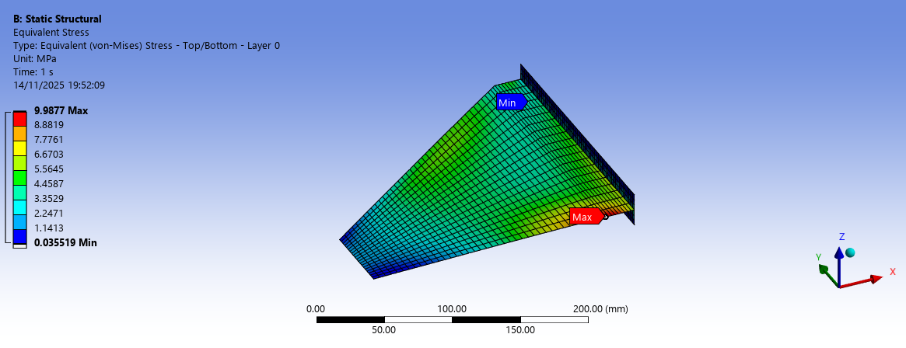
</p>

## Summary

| | |
|---|---|
| **Goal** | Verify the fins resist bending and flutter-relevant loads without excessive deformation or failure, and characterise the flow around the full rocket at peak velocity |
| **Tools** | SolidWorks, ANSYS Workbench (Mechanical, ACP), ANSYS Fluent |
| **Structural method** | Thin-shell model of a composite sandwich (wood core + glass-fibre skins), static structural analysis |
| **CFD method** | 3D compressible external aerodynamics, quarter-domain with symmetry, pressure far-field, k–ω SST |
| **Key result (design v1)** | Peak von Mises stress **9.98 MPa** vs. estimated allowable **≈ 13.4 MPa** (margin ≈ 25 %) |

## Repository structure

```
.
├── README.md
├── images/
│   ├── v1-structural/   # FEA figures, design v1
│   ├── v1-cfd/          # CFD figures, design v1 (pressure- vs density-based solver)
│   ├── v2-structural/   # FEA figures, design v2
│   └── v2-cfd/          # CFD figures, design v2
└── reports/
    ├── fin-design-v1-report.docx
    └── fin-design-v2-report.docx
```

---

## Part 1: Structural analysis of the fins

### Why
At high speed the fins see significant bending moments from aerodynamic forces. The fin layup had to be checked for bending resistance and flutter before manufacture.

### Geometry and modelling approach
The fins are modelled as a **thin shell**. In SolidWorks I extracted the midplanes of the fin faces and root, so the whole composite stack is represented by a single surface. This keeps the model cheap while still capturing the bending behaviour that matters.

<p align="center">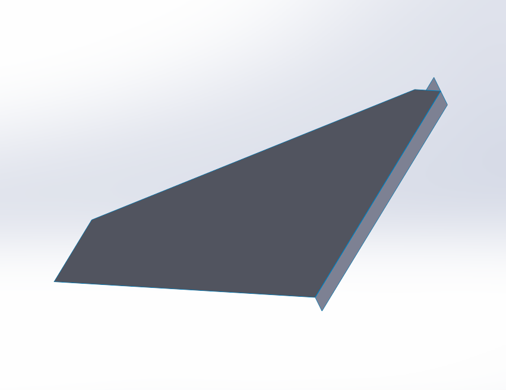</p>

### Composite layup (design v1)
Symmetric stack-up built in ACP:

| Layer | Material | Orientation |
|---|---|---|
| Core | Wood, 3 mm | 0° |
| Skin 1 | Glass fibre 500 g/m² | 0° |
| Skin 2 | Glass fibre 500 g/m² | 45° |
| Skin 3 | Glass fibre 240 g/m² | 90° |

The same three skin layers are mirrored on the other side of the core. The two heavy plies carry load; the 240 g/m² outer ply provides surface finish and extra reinforcement. Material properties were taken directly from the fibre manufacturers' datasheets and entered in ANSYS Engineering Data.

<p align="center">
  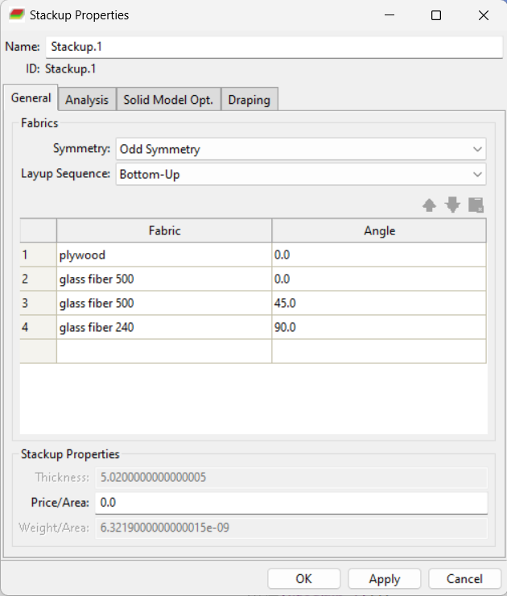
  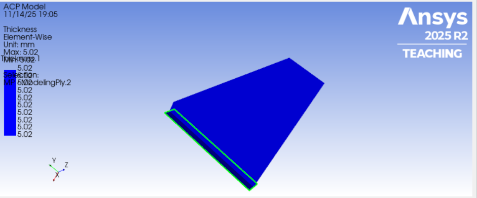
</p>

### FE setup
- **Mesh:** shell elements, refined at the fin root and edges where stress concentrates.
- **Boundary conditions:** fixed support at the fin root (attachment to the body).
- **Loads:** aerodynamic force on the fin surfaces, supplied by the flight dynamics team.
- **Solver:** static structural, ANSYS Workbench.

<p align="center"></p>

### Results (design v1)
<p align="center"></p>

- **Maximum equivalent (von Mises) stress: 9.98 MPa.**
- Estimated allowable stress for the composite: **≈ 13.4 MPa**.
- Stress peaks at the **fin root**, as expected from the bending moment transmitted through the attachment.
- The layup and geometry are structurally adequate for the applied loading.

---

## Part 2: Flight simulation (CFD)

### Why
The simulation is run at the **maximum-velocity point of the ascent**, which is the most critical condition for both structural loading and stability.

### Geometry and domain
- Full 3D rocket: nose cone, body tube, fin assembly.
- The nose tip is **slightly rounded** to avoid degenerate mesh elements and improve solver stability. This has negligible aerodynamic effect at the operating Mach number.
- A large enclosure is subtracted (Boolean) to give the fluid domain. It is sized so shocks and pressure waves dissipate before the boundaries and the wake can develop fully.
- Only a **quarter of the domain** is simulated, using symmetry planes, to cut computational cost.

<p align="center">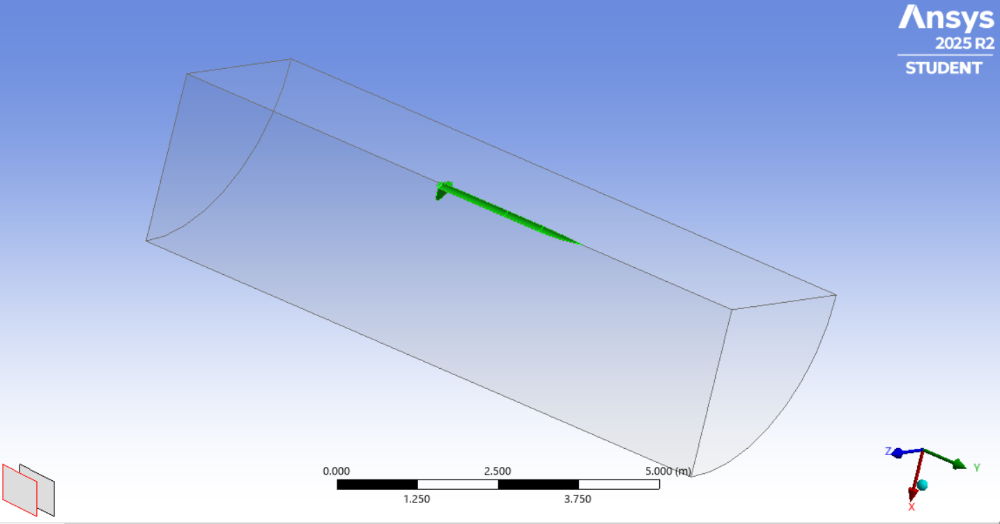</p>

### Boundary conditions
A **Pressure Far-Field** boundary is used. It is intended for compressible external flow and derives the freestream from Mach number, static pressure and static temperature (standard-atmosphere values at the flight altitude).

| Parameter | Design v1 | Design v2 |
|---|---|---|
| Freestream Mach | 0.93 | 0.74 |
| Turbulence intensity | 5 % | 5 % |
| Turbulent viscosity ratio | 10 | 10 |

<p align="center">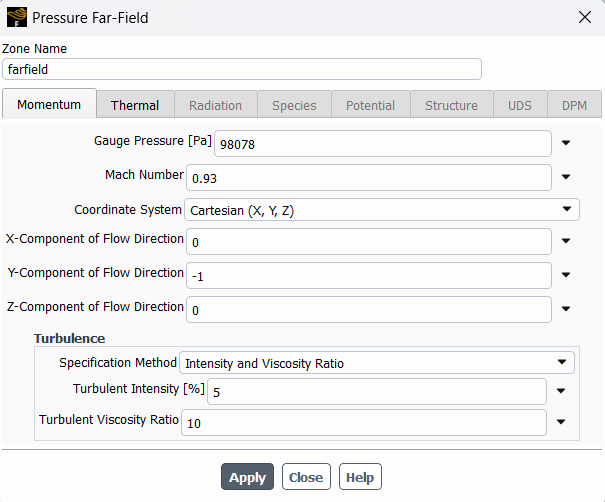</p>

### Solver setup
- **Density-based** solver (compressible, high-speed external flow); a **pressure-based** run is also shown for comparison
- **k–ω SST** turbulence model (near-wall accuracy, separation prediction)
- **Energy equation on** (compressibility and temperature effects)

### Convergence criteria
- Scaled residuals below **1×10⁻⁵** on continuity and energy
- A **drag report** on the rocket body was monitored, and the run was only accepted once drag reached a stable plateau (residuals *and* a physical quantity)

<p align="center"></p>

### Results (design v1): pressure-based vs density-based solver

| | Pressure-based | Density-based |
|---|---|---|
| **Temperature** |  |  |
| **Pressure** | 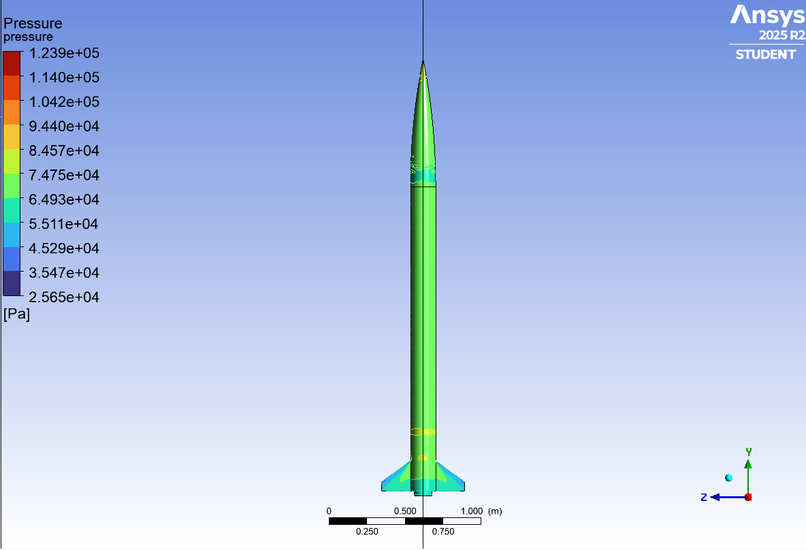 | 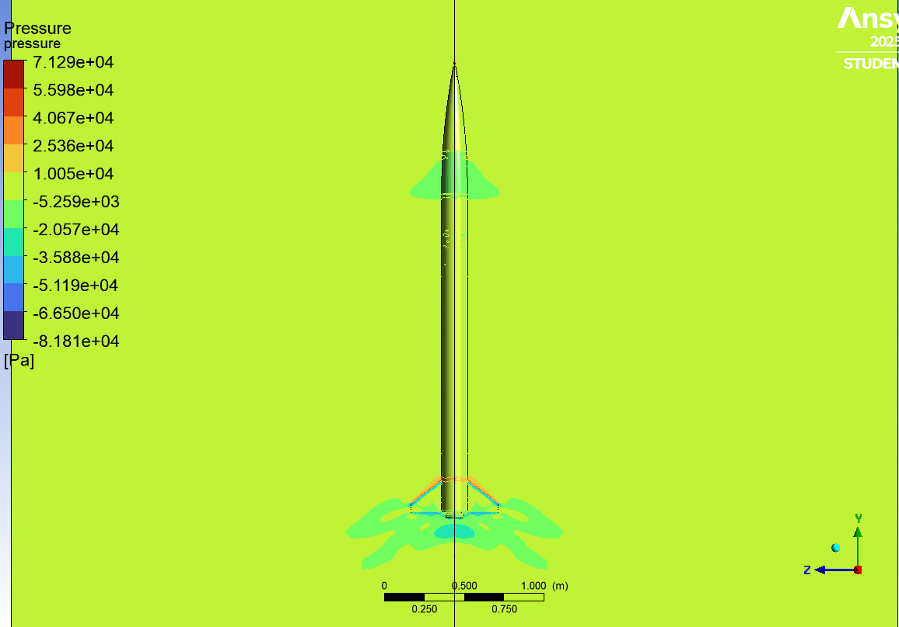 |
| **Velocity** |  |  |

---

## Design iteration v2

A second fin design was analysed with a lighter layup and mounting holes in the fin root.

| | v1 | v2 |
|---|---|---|
| Wood core | 3 mm | 2 mm |
| Glass fibre | 2 × 500 g/m² + 1 × 240 g/m² per side | 3 × 240 g/m² per side |
| Total thickness (ACP) | ≈ 5.0 mm | 4.1 mm |
| Fin geometry | Plain trapezoidal fin | Fin with two mounting holes |
| CFD freestream Mach | 0.93 | 0.74 |

<p align="center">
  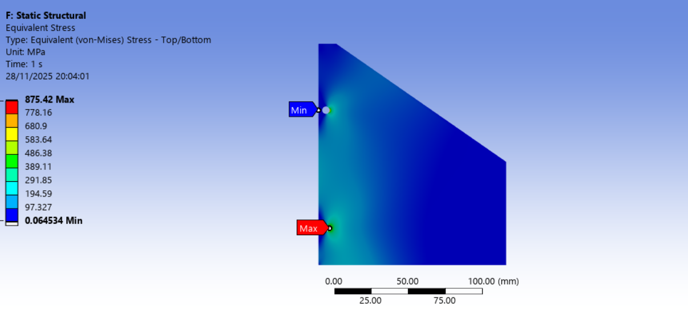
  
</p>

<p align="center">
  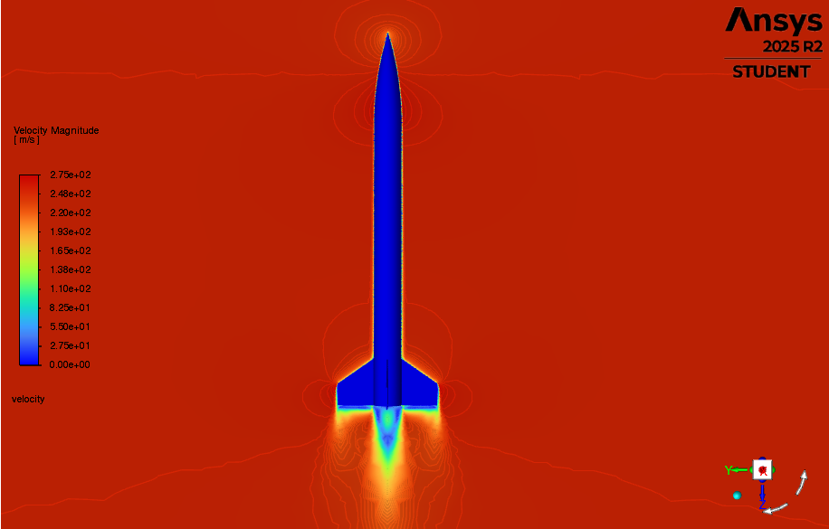
  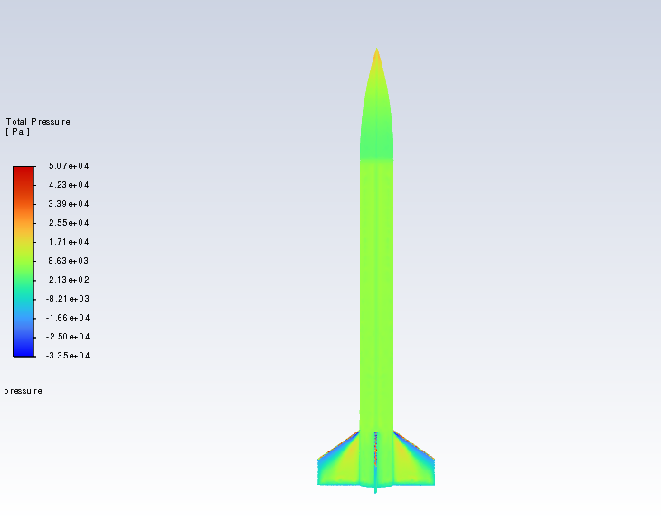
  
</p>

> **Status:** the v2 stress contour reports a peak of 875.42 MPa and a maximum deflection of 9.59 mm, with the maximum located at the lower mounting hole. This is far above the v1 result and the 13.4 MPa allowable, so v2 is documented here as an iteration in progress, not a validated design. See *Limitations*.

---

## Limitations and next steps
- Thin-shell idealisation ignores through-thickness effects (e.g. delamination, core shear).
- The structural load is a static equivalent supplied by the flight dynamics team; no aeroelastic (flutter) solve was performed, only a bending-strength check.
- The 13.4 MPa allowable is an estimate; it should be replaced by a failure criterion (e.g. Tsai-Wu or Hashin in ACP) and validated against coupon tests.
- Mesh-independence studies were not included in these reports.
- CFD loads are not yet coupled back to the FE model (one-way FSI would be the next step).

## Tools
SolidWorks · ANSYS Workbench · ANSYS Mechanical · ANSYS ACP · ANSYS Fluent

## Author
**[Your Name]**, [your degree / team], [LinkedIn URL]
